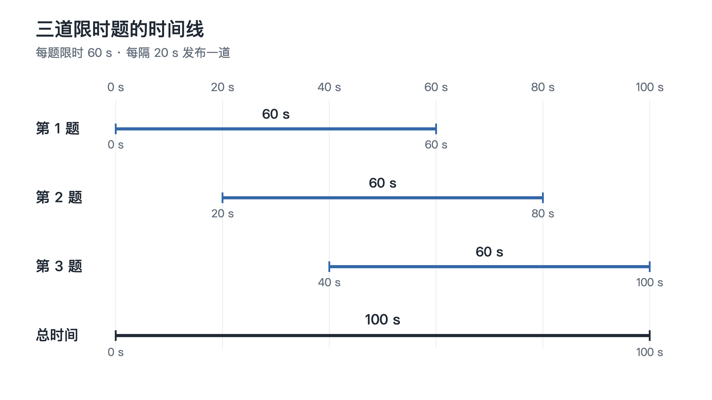
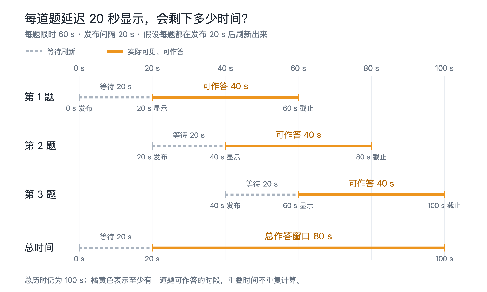
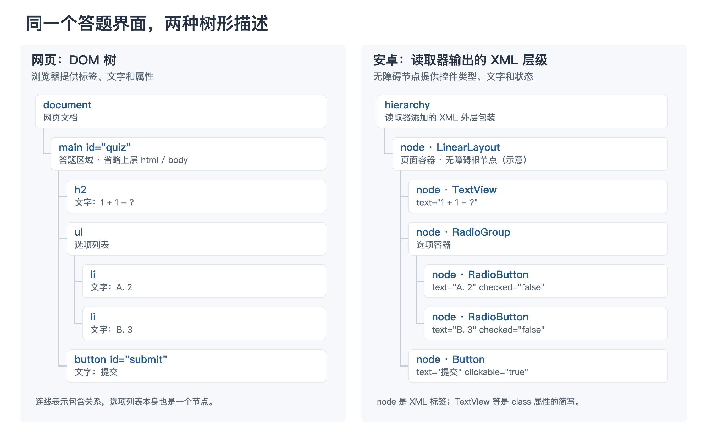

# 为了逃课，我做了个学习通自动答题脚本

## 前情提要

软件工程一开课，老师说：大家把学习通准备好，我们会频繁用到这个。

第一节课，他发了十几条随堂练习，两个投票。每条时间限制都是一分钟。

“这人有病吧，这样防逃课？”我心里暗自问候他的祖宗十八代。

这种防逃课机制反而触碰到了我的逆鳞。他越不让我逃，我越想逃。

正好最近充值了codex的pro会员，现在token有了新用处。

于是，我vibe了一个运行在自己电脑上的学习通本地答题脚本。

## 怎么获取题目，投票这些活动

### 网页端的坑

一开始，我的思路很简单。

直接写个python脚本，让他监看我的学习通网页端变化，有随堂练习和投票活动直接点进去做了，不就好了？

至于具体监看什么网页，可以使用一个方便的codex插件：ego-browser，这就是个给agent用的浏览器，可以方便地取得控制权和把控制权还给agent。

我在ego打开软件工程的学习通界面，然后兴奋地告诉codex：

>帮我写个脚本，监看当前ego中显示的这个网页，每5秒刷新一次状态，如果有题目，投票等活动就让ai点进去并完成。

codex很快把这个脚本造出来了，其中的ai功能后面再说，这里还没有跑到ai的部分就被中断了。

开始实际运行测试，20秒后，codex说：你的学习通一直提示操作过于频繁。

我看了眼网页端，自己试了几次，确实一直跳操作频繁，学习通拒绝继续刷新。这是很多网站为了防止攻击的常用手段：不让用户频繁操作。

能不能把刷新频率调低呢？我考虑了一下第一节课的情况，在老师发题目最频繁那一段时间，大概也就是30秒一个；我在和舍友创建的学习通机制测试群中试了一下，即便拿出我单身20年的手速，并且确保聚精会神，不点错按钮和调错设置，在学习通的反人类前端也只能实现一分钟发2～3道题。

假设我们的老师经过极为严苛的训练，能每20秒发一道题，连发三道。第一题在第0秒发，第60秒截止；第二题在第20秒发，第80秒截止；第三题在第40秒发，第100秒截止。从第一题发出来到最后一题关门，总共100秒。



第一题不难，有60s的时间；但是假如我们交第一题就用了60s，后两道题就十分紧迫。

假如每20秒刷新一次，偏偏老师每次都赶在刚刷完的时候发题，那每道题都得等将近20秒才能被看见。等题目刷出来，自己那一分钟就只剩大约40秒了。



这还是每20秒能顺利刷新一次的情况。两次刷新隔得越久，最倒霉的那道题就得等得越久。

如果这个老登心血来潮，连发四五道题目，那我们这个脚本可能除了前两题有几率能答出来，后面的平时分基本就是没了。

想到这里，我把刷新间隔调到了20秒，看看学习通这次肯不肯让我刷。

刷了几次，又跳了那个操作过于频繁的窗口。

看来在网页端写脚本是行不通了。事情没我想的那么简单。

### 网页端不行，换到模拟器试试。

网页端有一个特性：那就是刷新是不明确的。当老师发布一个题目，你不知道网页端会在这一秒刷新，还是等题目过期了也不刷新。手动刷新，一个是不能及时获得题目，另一个，就算把刷新频率降的很低也会触发网页的防频繁操作保护。这使得在网页端部署脚本是几乎不可能的事情。

但是手机端就不一样了，老师发布一个题目，手机端立刻就可以收到。不需要手动刷新，几乎没有延迟。

我一开始想的是在我的手机上部署一个脚本。我的手机是一加12，一加这个牌子的手机部署脚本很方便。我之前在我的一加9R上部署过一个大麦抢票脚本，虽然那个脚本实际上并没有如预期工作，但也给我积攒了在手机上部署脚本的经验。

在我满电脑找之前那个安卓控制工具的时候，我突然想到，逃课的目的不就是为了换个地方玩手机吗？我把手机拿来跑脚本，那我逃课的时候玩什么？

这当然难不倒聪明的我。我在电脑上下载了一个安卓模拟器，然后下载学习通，登录，打开群聊页面。只要在这个页面，我随时都可以获取到最新的学习通群聊状态，不用管延迟，也不需要手动刷新。

这时候，就可以开始部署脚本了。

### 模拟器怎么实现脚本

让 Python 监看网页，可以从浏览器里的 DOM 树入手。你在页面上看到题干、选项和按钮，脚本能从树里找到对应的元素，再让浏览器去点。换成安卓模拟器，Python 又上哪儿找这些东西？

我在模拟器里另外装了个小工具，专门读学习通当前打开的界面。Python 通过 ADB（安卓调试桥）去读，它向安卓的无障碍接口要来当前窗口的节点树，把控件的文字、位置、能不能点这些信息整理成 XML，再通过 ADB 传回来。这样 Python 就知道眼前这个按钮写着什么、长在哪儿了。



这也会遇到很多问题。

比如，有些按钮需要滚动页面才可以点击，选项按钮需要关掉课程通知的窗口才可以点击。这些复杂的逻辑，最好的应对办法就是多试。我是在测试群里发送了各种诡异格式的题目，判断，投票，2～12个选项的单选，让ai一个一个适配。最重要的就是别有“这个可以，那这个应该也可以”的侥幸心理，即便我做了那么多适配，在实践过程还是遇见了不少难以适配的地方。

其中有一道七个选项的单选题，我发出去，等了半天，没等到提交回执。后来回学习通里看，确实没交上。

跟着 Codex 查这道题的时候，发现提交按钮被挤到了屏幕底下，只露出一个像素。安卓无障碍接口对这个按钮的评价是：可见。

好严谨。它确实没说看见了多少。

所以，我们不光要确定脚本能不能看见提交按钮，还要知道其能否点得到。如果按钮没完全漏出来，就得滑动一下页面，判断新的按钮位置再点。

又比如，当选项里混入一张图片，这套办法就炸了。人看得见图里写了什么，读取器拿到的节点却可能只告诉它这里有张图。要是节点里也没给文字描述，Python 连选项都读不全。我打算后面再试试 OCR，现在先说纯文字题。

### 模拟器的坑

一开始，我觉得ai很容易做出来这些简单的软件工程问题。

我直接让codex把脚本接上我的OpenAPI，使用便宜又好用的6.1 Sol模型，中等思考强度，试了几道题。

确实都做对了，于是我开始实际在学习通里实验。

#### 学习通的系统通知是垃圾

我把脚本打开，在测试群里发了两道题，分别是2个和4个选项的单选题。直到两道题完全过期，脚本都没有任何反应。

我开始跟着 Codex 排查。当时我让模拟器里的通知监听服务等学习通发系统通知，再通过 ADB 建好的通道把消息传给电脑。题目已经发出来是一回事，学习通肯不肯发通知又是另一回事。它要是一直不发，脚本就在那儿一直等。

问题是，学习通是一个很屎的软件。

不光通知有让人摸不清楚的延迟，有时甚至课堂活动结束了也没有通知。

而且从收到通知再开始从通知点进活动，大多数时候还要转好久的圈。网络繁忙时，还可能进不去。

没人知道他在忙什么，反正他就是很忙。

所以通过通知获取活动，这条路行不通。

#### 监看系统通知不行，我想到了两种取代方案

在学习通里，如果你想稳定地获取这个群聊里新发的活动，你必须打开学习通，然后通过这两个地方获取：
1.在任何学习通页面，收到的课堂活动的全局置顶弹窗；
2.打开这个群聊的消息列表。


#### 课堂活动的弹窗

当你在学习通的任何界面收到一项课堂活动，一般都会给你一个全局置顶的课堂活动弹窗，你可以通过这个弹窗进入活动（这里一般也会转一会圈）。

这个弹窗不像系统通知那样随心所欲，它是稳定触发的，无论你在首页，群聊界面，还是题目界面。所以，这看起来是个十分稳定的办法。

我让codex把脚本监看的地方从系统通知改成学习通的课堂活动弹窗。然后再次测试。

发一道题，它确实做出来了。

（怎么做出来的，见后面的[打开题目了，怎么选择正确答案](#打开题目了怎么选择正确答案)。）

我以为完事了，于是又连发了三道题，看看他能不能在比较极限的工况下正常工作。

这次，它一道题也没做出来。

为什么？

刚才，我们埋了一个伏笔：

>“这个弹窗不像系统通知那样随心所欲，它是稳定触发的，无论你在首页，群聊界面，还是题目界面。”

所以，当脚本收到并进入第一题，还在思考这道题怎么做的时候，第二题的弹窗来了。

脚本的逻辑还停留在等答案这一层，当他从大语言模型那里拿到答案，兴冲冲地准备选答案并提交时，发现原来的选项界面没了，屏幕上是一个雷霆大弹窗。

这下脚本傻了：“代码里没写有弹窗的事啊？”

我们也不能粗暴地让脚本关掉弹窗。因为我们就是靠弹窗来获取活动的。

所以这种办法行不通。

#### 最终版解决方案：直接看群聊里有哪些活动。

踩了这么多坑，我最后决定让脚本盯着群聊里的活动卡片。这样下次再来个雷霆大弹窗，我终于敢点“取消”了，活动还在群里。

第一次监看这个群，脚本先把这一轮扫到的卡片记进本地数据库，算作“群内已有”。总不能我刚打开脚本，它就扭头去做上次课的题吧。

之后，脚本一轮一轮地读群聊的节点树，拿看到的卡片去跟数据库比对。发现近期的新卡片，认出是我开启处理的练习或投票，就把它加进任务队列。同一张卡片看见好几遍，也只排一次队。

每轮只挑一张。脚本先从能处理的卡片里挑发布时间最早的那张，再去群聊里找它。要是这一屏已经看不见了，就翻一翻聊天记录，找到再点进去。

点了提交，还得看学习通有没有给回执。处理完一题，脚本就回群补扫一次，再挑下一张。比如做第一题时老师又发了两道，脚本当时还在答题页，等它回群才有机会把那两道补进队列。

这样，连发的题目总算有地方排队了。但从打开题目到选出正确答案，再把答案交上去，还有不少活要干。

## 打开题目了，怎么选择正确答案

前面说过，脚本已经能从安卓的无障碍节点树里读出文字题的题干和选项了。接下来该找个大语言模型做题，再让它按约定的格式把答案交回来。总不能它洋洋洒洒写了一页解析，脚本还在等一个 B。

所以最容易想到的办法，就是接个api。

一开始想的是，拿pro会员送的免费openAPI额度。但是那时候刚充值完pro会员，还得等近一个星期免费额度才能到账。我想早点跑通，同时想一个免费的办法来回答题目。

### 大肥鱼，我恨你

于是，我想到了第一个办法：蹭网页端的免费deepseek用。

这样测试了五道题，答的又快又好，每道题就一点几秒，最慢的没超过2秒就返回了答案。

但是这建立在一个前提之下：网页端已经登录，并正确关闭了深度思考和智能搜索功能。

如果开启了智能搜索，会变慢一些，

但是这些都是不稳定的。

一旦页面刷新，智能搜索会被自动开启；

频繁提问，网页端会跳人工验证；

而且脚本还可能会扩展一键启动，如果每次都要在浏览器开启deepseek并登录，并且还可能需要重新登录，会非常麻烦和不优雅。

所以deepseek网页端，能蹭，但是会很麻烦和不稳定。

### 本地轻量模型 + BM25检索

由于课程的题目基本都问的是软件工程知识，我们只需要把课件整理成一个知识库，然后让一个本地的轻量模型根据知识库回答题目就行了。

我先用了 BM25。题干里的问法可能跟老师的课件对不上，好在选择题自己还带着几个选项。把选项里的课程术语也拿去搜，就多了几次对上课件原词的机会。

我在本地部署了 Qwen3-4B-Instruct-2507，让 Codex 把这门课的课件按页提取成文字，每页记下文件名和页码。脚本启动时，Python 再把长页切成小段，后面做题就拿这些段落来查。

每道题都拿题干和所有选项一起搜。BM25 给课件片段打分，从高到低最多挑两段，同一页只取一次。Python 把挑出来的原文连同题目、选项一起交给本地模型，模型再把选项编号返回给脚本。以后我倒想试试多给它几段，看看能多做对几道，又得多等几秒。

到目前为止，脚本实际做了几十道题，我还没发现它选错过。倒是有件比选错更尴尬的事：模型都准备好了，脚本连题目都没读出来。

## 唯一目前没有完全解决的坑：能打开题目，但脚本不认识题目形式，直接罢工

这种罢工的情况，在测试阶段常见于各种诡异形式的题目：各种选项数量的单选题，判断题。还有单选投票和多选投票。

试了几次，每次遇到需要人工核验的就让codex适配该种题目，搞了一下午，然后脚本基本都能做出来了。

折腾到这一步，在我测过的纯文字页面里，一次活动一道题的单选和判断都能处理，投票也跑通了单选和多选。容易搞混的是随堂练习里的多选题，这个我当时还没适配。

正当我信心满满地打算用这个脚本逃晚上这节课时，老师在课堂一开始连发的三道题目，脚本全都显示：需要人工操作。

我傻了。我适配了那么多种题目，怎么会出现这种情况？

点开一看，嚯。这三道题完美触及了我脚本的知识盲区———它们都包含了图片。

## OCR，启动！

之前能答题，是因为题干和选项里的字可以直接从无障碍节点树里读出来。

可是如果题里的任意一部分变为图片，脚本就读不出来了。

举个例子，假设一道题目的一个选项为文字，一个选项为图片。

当脚本调用读取器，读取器会通过安卓无障碍接口读取当前窗口的结点树，并返回一个XML给脚本，这个XML里面包含了题目。

当选项为文字时，读取器会返回形如这样的XML：

```xml
<node class="android.widget.RadioButton" text="A" />
<node class="android.widget.TextView" text="将借阅记录、库存数量和还书流水放在同一个数据库事务中更新" />
```

“将借阅记录、库存数量和还书流水放在同一个数据库事务中更新”是选项的文字。

后端从 XML 里把题干和各个选项的文字提出来，拿这些文字去知识库里查课件，再把题目和查到的课件片段一起喂给本地模型，让它选个答案。

选项为图片时，则会这样返回：

```xml
<node class="android.widget.RadioButton" text="A" />
<node class="android.widget.Image" text="" content-desc=""
      bounds="[80,420][900,560]" />
```

这回 `text` 是空的。脚本还知道这是 A 选项，也能从 `bounds` 看出图在哪儿，就是不知道图里写了啥。好在位置已经有了，给脚本长双眼睛就行。

于是我把 OCR 接到了读题这一步。题干和选项都是文字，就照旧从 XML 里读。碰到上面这种内嵌图，就按 `bounds` 从截图里把图裁出来交给 OCR。碰到能点开的图片附件，就点开原图再读。脚本取图时已经记下了这张图属于 A，所以 OCR 认出来的那句话会被放进 A 选项的正文里。等题干和选项都读全了，后面还是老流程，查课件，问模型。

编了几道图片文字混合的单选题试了下，都顺利做出来了。耗时每道从20s左右变成了每道40s左右。虽然40s也勉强够用，但是速度还是不足以应付所有类型的题目。这个我们后面再优化。

## 结尾

写到这里，脚本已经能替我答题了。但如果每次上课前，我还得记得去电脑前把它打开，那我大概率会在下课以后想起这件事。

所以我又给它加了个定时开关，到点自己开，下课自己关。为了知道它到底会不会自己起来干活，我在 Windows 上临时排了一节只有五分钟的课。到点以后，脚本正常启动了；五分钟后，脚本也自动关了。

这样，我就可以把闲置的电脑放在宿舍，让他在上课时间自动给我答题了。唯一的缺点，就是一些偏门题目，和一些很多题连在一块的测试还没适配。

我能放心地把手机揣兜里逃课了吗？

上节课，我想着再最后看看脚本的表现，于是把闲置电脑在宿舍开着，我去课上用uu远程监看脚本运行。

老师在课上发了一堆快答和练习。一堆连成串的选择题，一长串填空题。没有脚本擅长的，形单影只的单项选择题、投票和判断。

我暗自问候老师的祖宗十八代。

现在，还不能逃课。